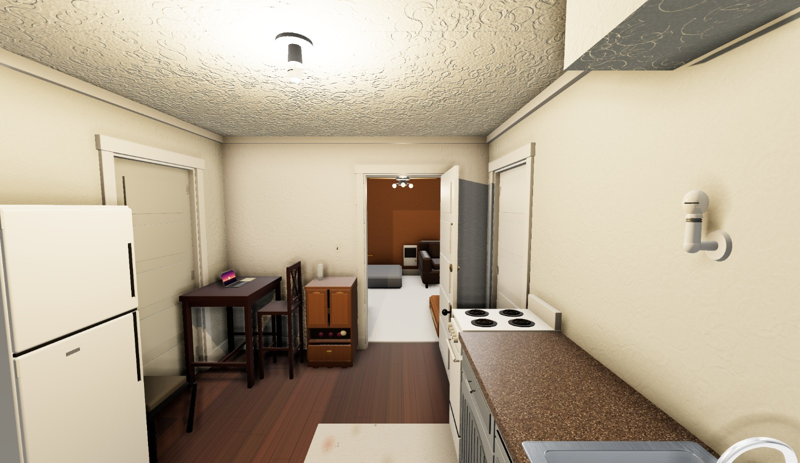
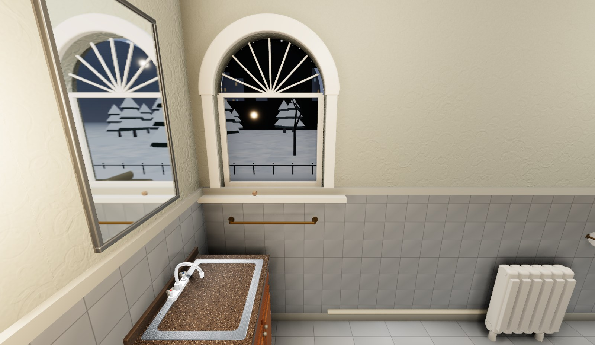
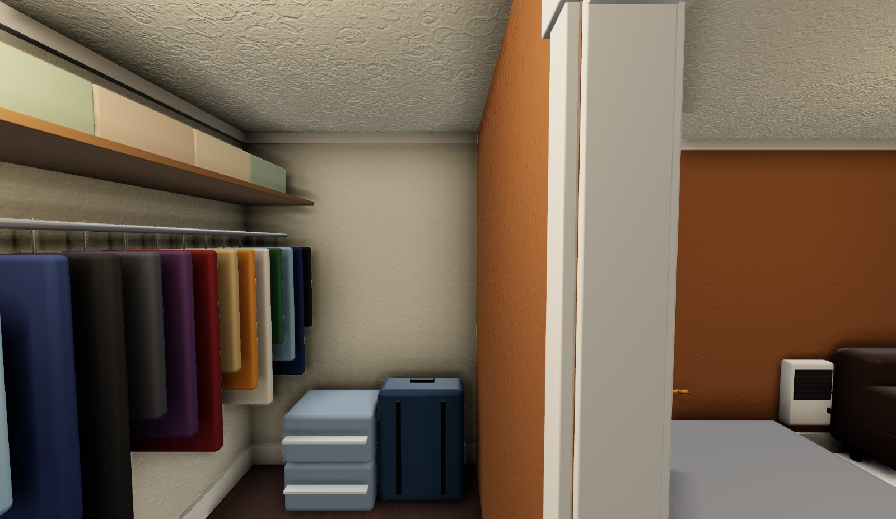
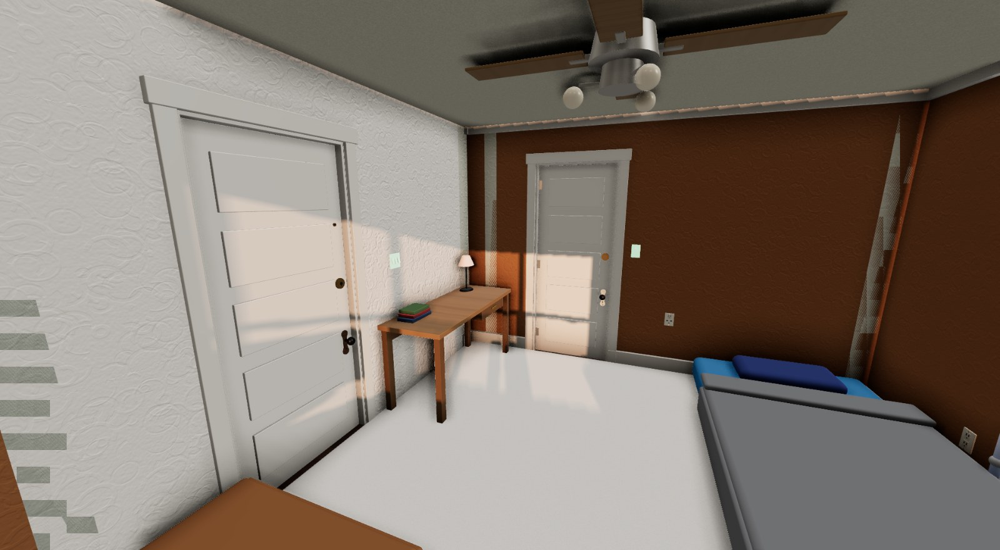
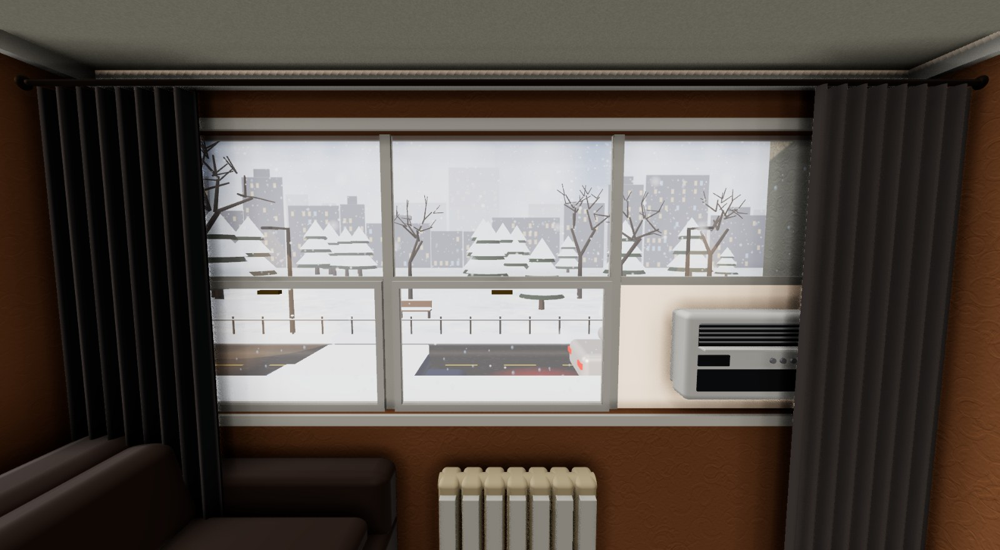
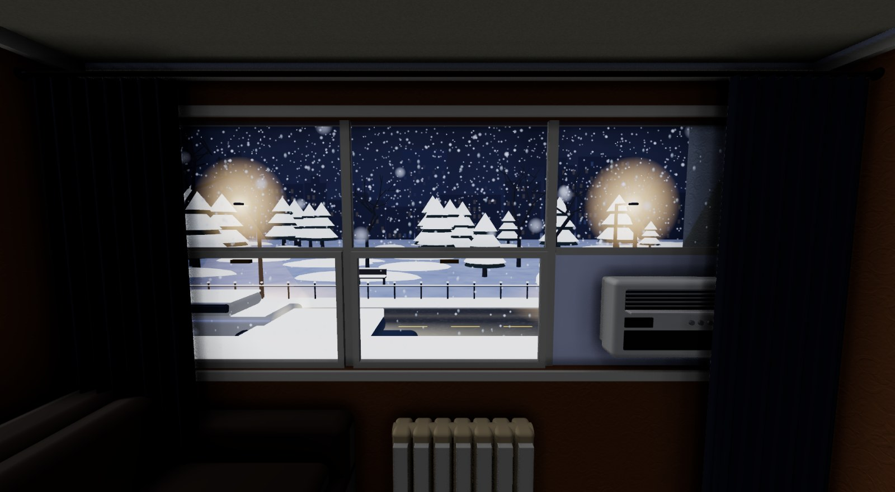

# 277 Park Ave #11 — a first-person apartment in three.js

A walkable, first-person replica of a real apartment, built **asset by asset** from photos with procedural three.js geometry
(no imported models). It's a personal "just for fun" project: kitchen, bathroom, bedroom with a walk-in wardrobe, the hallway
outside the entrance, and a winter street + park outside the bedroom window.

Every object is its own labelled, draggable, resizable asset, and you can paint the walls. Things work like a small game:
sit on chairs, use the toilet (lid up, flush, lock the door), take a shower, switch lights / fan / AC, open doors and curtains.

## Preview

| Kitchen | Bedroom |
| --- | --- |
|  |  |
| **Bathroom** | **Wardrobe** |
|  |  |


### Dynamic day / night cycle

Sunlight really moves through the apartment: a shadow-casting sun crosses the sky, walls, ceilings and window frames cast real
shadows, and light only gets in through the windows (or an open door), so the bright patches slide across the floor and walls as the
day goes by. Morning, afternoon, sunset and night each look different, outside too: sky colours, the sun and moon on their arcs,
clouds, stars, street lamps and car headlights switching on at dusk.

| Afternoon sun through the bedroom window | Morning |
| --- | --- |
|  |  |
| **Sunset** | **Night** |
|  |  |


## Run it

```bash
npm install
npm run dev        # http://localhost:5173
```

Units are metres: `x` = east, `y` = up, `z` = south. Dimensions are estimates from photos and live in `src/config.js`.

## Controls

| Key | Action |
| --- | --- |
| `W A S D` / `Shift` | walk / run (mouse to look) |
| `E` | use what you're looking at (doors, switches, taps, curtains, valves…) |
| `Y` | sit on a chair / use the toilet / take a shower |
| `X` | change colours of the object or wall you're looking at |
| `Q` | lock / unlock the bathroom door (from inside) |
| `R` | bathroom rug on / off |
| `L` | **Layout mode** — drag, rotate and resize objects |
| `F` | **Feedback mode** — leave notes pinned to what you see |
| `H` | cycle hand position: Auto (hands rise when you look at something to use) / Up / Natural / Down |
| `G` | lock / unlock the front door: key from the hallway side, deadbolt thumb-turn from inside |
| `P` | save a screenshot of the current view to `docs/screenshots/` (dev server only) |
| `Esc` | release the mouse |

## Project layout

```
src/config.js          room sizes, doors, furniture defaults
src/main.js            scene, loop, interaction, per-room lighting
src/shell/             rooms: kitchen, bathroom, bedroom, hallway, walls, winter street view
src/fpbody.js          first-person body: torso, sleeves, IK arms, hands (layer 1, sees only through your eyes)
src/avatar.js          shared avatar identity (shirt + skin colours)
src/daycycle.js        real-time sun + moon position, sky colours, shadow-casting light
src/weather.js         live Youngstown weather (Open-Meteo)
src/fixtures/          sink, toilet, stove, fridge, lights, rugs, power outlets…
src/layout.js          Layout mode (drag / resize / save positions)
src/paint.js           colour modal;  src/wallpaint.js  paintable walls
src/feedback.js        Feedback mode
docs/screenshots/      preview images used by this README
src/activity.js        sit / toilet / shower (first person)
layout.json            saved positions, sizes and colours (written by Layout mode)
layout-backups/        automatic copy of the previous layout on every save
feedback/              notes made in Feedback mode (see below)
```

## Real time + live weather

The apartment is labelled **277 Park Ave #11, Youngstown, OH**. On load it takes the real time (US Eastern) and computes where the
sun and moon actually are over Youngstown (astronomical formulas, no API), so the sunlight through the windows matches the real sky
right now, and the moon follows its real phase. The weather comes live from [Open-Meteo](https://open-meteo.com) (no key; only
Youngstown's public coordinates are sent, refreshed every 10 minutes): snow, rain, fog, cloud cover, wind and temperature drive the
view outside. If the request fails it falls back to a snowy default. A small label at the bottom shows place, time, phase and weather.

## Layout mode (`L`) and `layout.json`

Click an object, drag it to move, use the coloured dots to resize/rotate. Wall fixtures (outlets, switches, heater) follow the
pointer over any wall at any height. **Save layout** posts to the dev server, which writes `layout.json` and first copies the
previous file into `layout-backups/`. The saved layout (positions, sizes, colours, wall paint) is re-applied on every load.
Saving only works while `npm run dev` is running.

## Feedback workflow (how notes get from the browser into the code)

Feedback mode is how I review the build while developing: instead of describing problems in words, I point at them.

1. Run `npm run dev`, open the preview and press **`F`**.
2. Click any surface or object, type a comment and pick a type (`fix`, `add`, `remove`, `move`, `other`), then add the note.
   Each note records the clicked object (name, path, size, material), the exact 3D point and surface normal, and the camera
   position / yaw / pitch so the view can be reproduced. A JPEG screenshot of the view is attached.
3. Saving POSTs the notes to a small Vite dev-server plugin (`feedbackSink` in `vite.config.js`), which writes:
   - `feedback/feedback-<timestamp>.json` — the notes
   - `feedback/shots/<timestamp>-NN.jpg` — one screenshot per note
4. **Processing:** at the start of a development session, read every `feedback-*.json` in `feedback/`, apply the notes (the
   `target.path` and `point` say exactly where), then move the file and its screenshots into `feedback/processed/` and
   `feedback/processed/shots/` so the inbox only ever holds unhandled notes.

Details are in `feedback/README.md`. Like layout saving, this needs the dev server (`npm run dev`) — it's a development tool,
not part of a production build.

## Updating the screenshots in this README

The images above are real captures of the running preview, saved by the dev server (`snapshotSink` in `vite.config.js`):

- Press **`P`** while walking around to save the current view as `docs/screenshots/snapshot-<timestamp>.jpg`.
- Or from the browser console: `__fp.snapshot('my-name')` saves `docs/screenshots/my-name.jpg` (use `__fp.teleport(x, z, yaw)` first to
  position the camera). The README's images were taken this way, one call per room.
- Then point the `` lines in this README at the new files, commit and push.

## Tech

[three.js](https://threejs.org) `^0.170` + [Vite](https://vite.dev) 6. All geometry, textures (canvas), and the winter scene are
generated in code.

## UI design system (glass)

All UI is built from `src/ui/glass.css` (tokens: fill, blur, borders, radii, type, shadows, motion) and `src/ui/glass.js`
(`glassShow` / `glassHide` for entrance and exit animations). New panels should use `g-glass` (+ `g-strong`, `g-pill`, `g-pad`),
`g-scrim` for modals, `g-tip` for tooltips; buttons, inputs, kbd and selects inside them are styled automatically.
Don't hard-code colours, blur or radii in individual components.
