# 277 Park Ave #11 — a first-person apartment in three.js

A walkable, first-person replica of a real apartment, built **asset by asset** from photos with procedural three.js geometry
(no imported models). It's a personal "just for fun" project: kitchen, bathroom, bedroom with a walk-in wardrobe, the hallway
outside the entrance, and a winter street + park outside the bedroom window.

Every object is its own labelled, draggable, resizable, paintable asset. Things work like a small game (sit, use the toilet, take a
shower, switch lights / fan / AC, open doors and curtains), there is a smart-home **Command Center** dashboard over the live
apartment, and the project is developed with a built-in **feedback loop**: the owner points at problems in the preview, and the notes
(with screenshots and exact 3D coordinates) are processed in the next development session.

**Contents:** [Preview](#preview) · [Run it](#run-it) · [Controls](#controls) · [Walking around and interacting](#walking-around-and-interacting) ·
[Day / night, weather and lighting](#day--night-weather-and-lighting) · [Command Center](#smart-home-command-center-tab-or-the-pill-at-top-left) ·
[Add from first person](#add-an-object-from-first-person-n) · [Layout mode (dragging)](#layout-mode-l-dragging-resizing-and-layoutjson) ·
[Painting](#painting-x) · [Feedback loop](#feedback-mode-f-and-how-it-drives-development) · [Screenshots](#updating-the-screenshots-in-this-readme) ·
[Project layout](#project-layout) · [Design system](#ui-design-system-glass) · [Tech](#tech)

## Preview

| Kitchen | Bedroom |
| --- | --- |
|  | 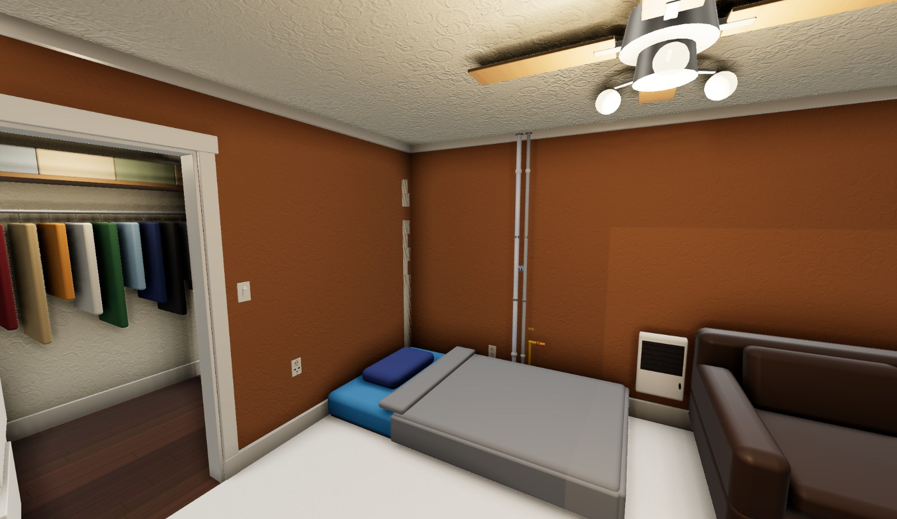 |
| **Bathroom** | **Wardrobe** |
|  |  |

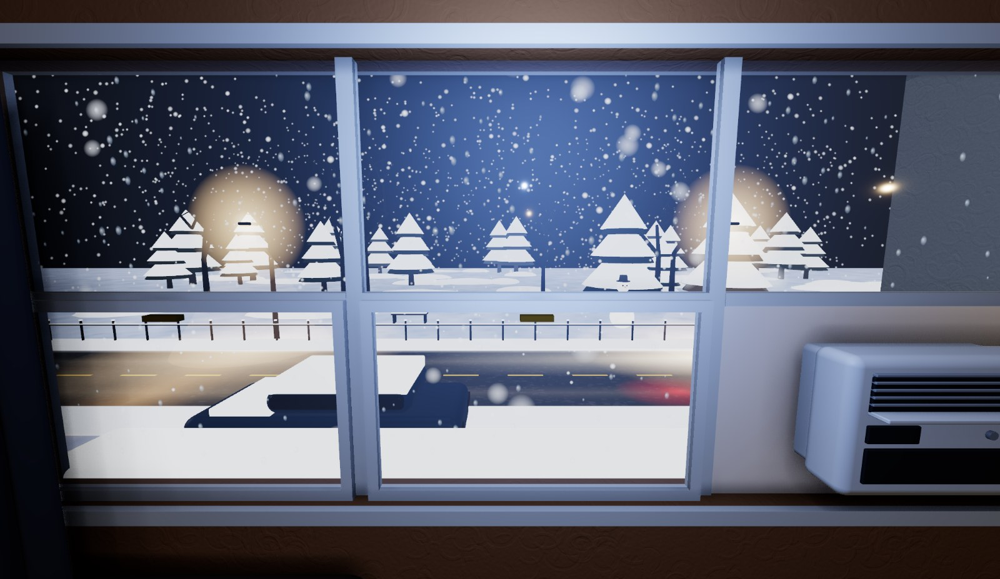

### Day / night cycle

Sunlight really moves through the apartment: a shadow-casting sun crosses the sky, walls, ceilings and window frames cast real
shadows, and light only gets in through the windows (or an open door), so the bright patches slide across the floor and walls as the
day goes by. Morning, afternoon, sunset and night each look different, outside too: sky colours, the sun and moon on their arcs,
clouds, stars, street lamps and car headlights switching on at dusk.

| Afternoon sun through the bedroom window | Morning |
| --- | --- |
|  |  |
| **Sunset** | **Night** |
| 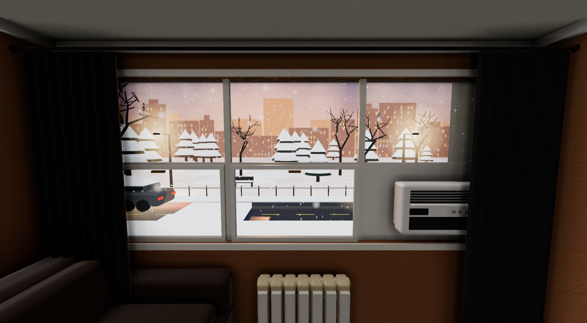 |  |

### Tools and dashboards

| Command Center: home | Command Center: cameras |
| --- | --- |
| 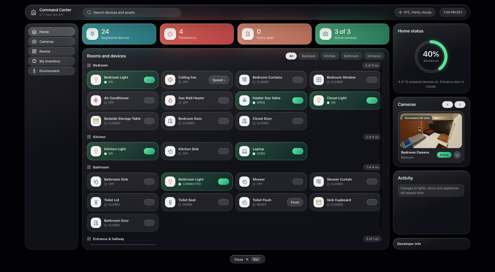 | 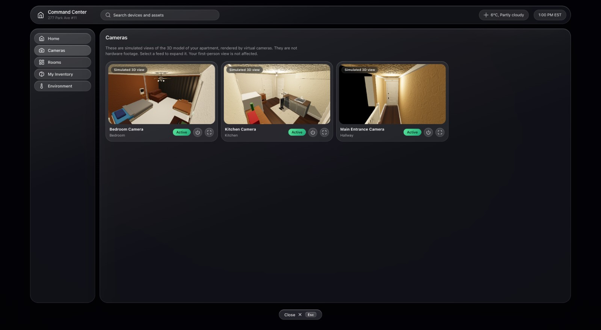 |
| **My Inventory** | **Environment** |
| 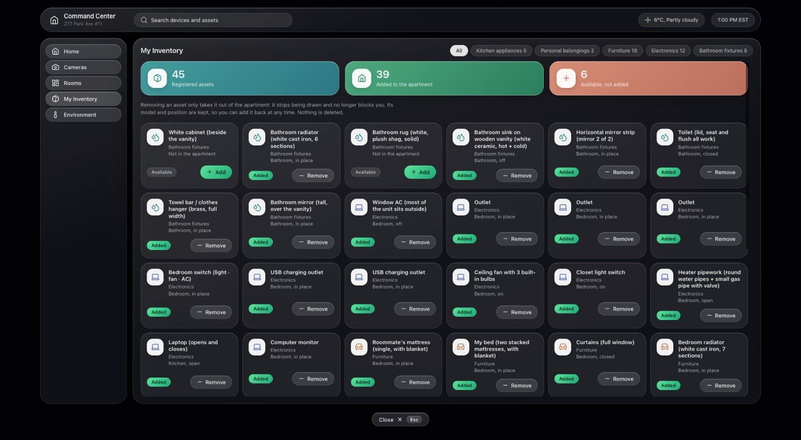 | 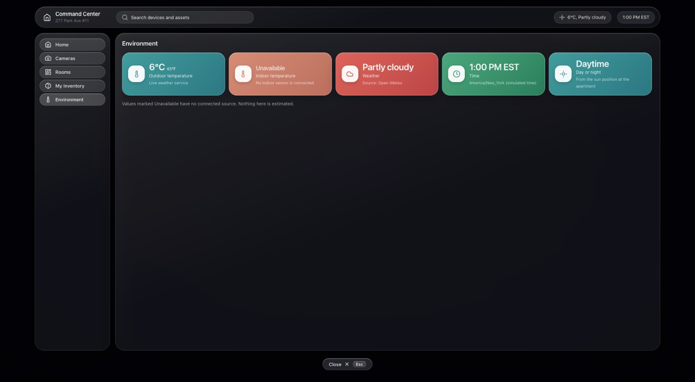 |
| **Add from first person (N)** | **Layout mode (L)** |
| 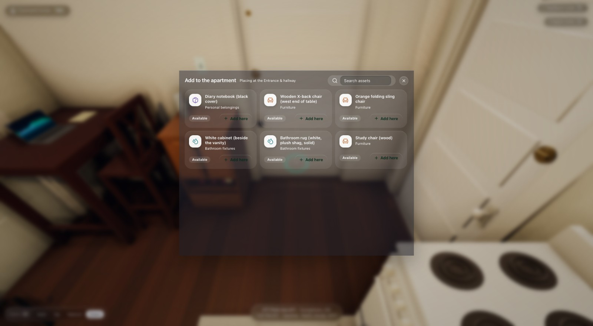 | 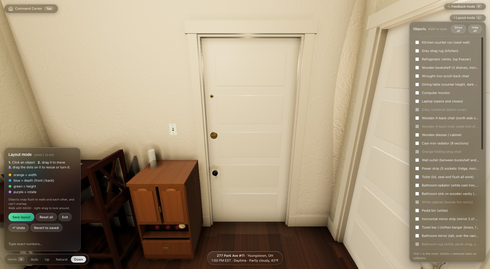 |
| **Command Center: rooms** | **Start screen and controls** |
| 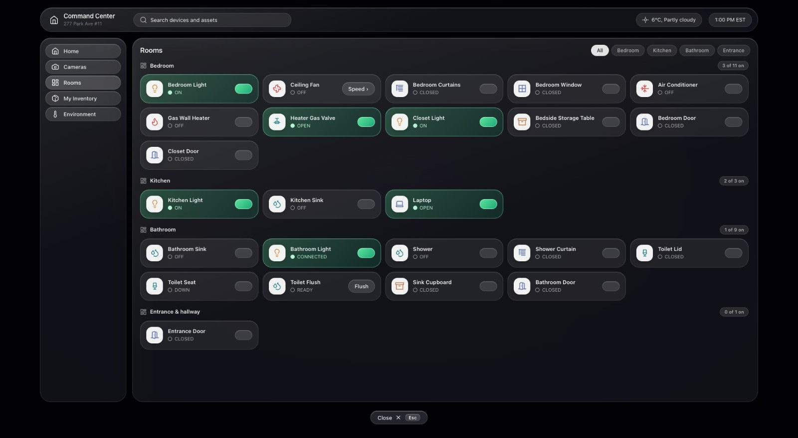 | 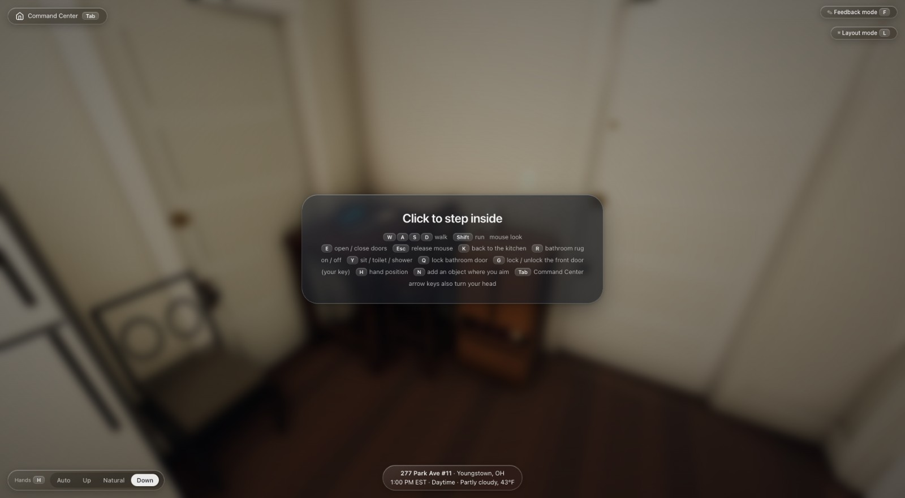 |

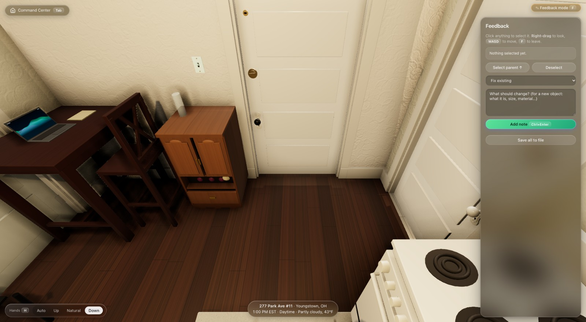

### The refrigerator

| Branded, closed | Open and stocked |
| --- | --- |
| 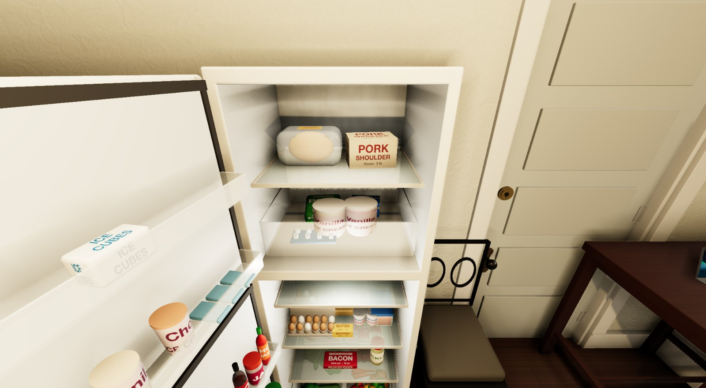 | 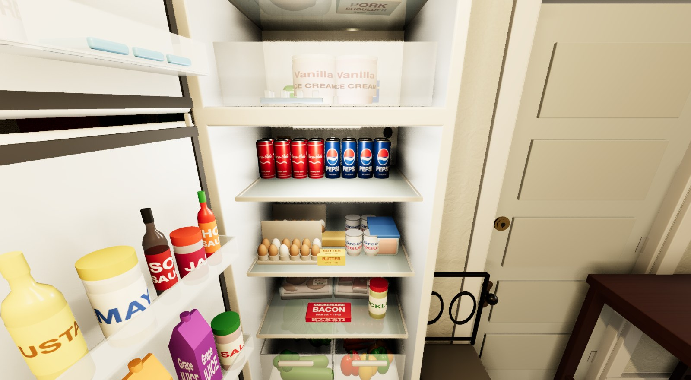 |

## Run it

```bash
npm install
npm run dev        # http://localhost:5173
```

Units are metres: `x` = east, `y` = up, `z` = south. Dimensions are estimates from photos and live in `src/config.js`.
Layout saving, feedback saving and screenshots are written by small plugins in `vite.config.js`, so they only work while the
dev server is running (they are development tools, not part of a production build).

## Controls

Click the start overlay to capture the mouse (arrow keys also turn your head). `Esc` releases it.

| Key | Action |
| --- | --- |
| `W A S D` / `Shift` | walk / run (mouse to look) |
| `E` | use what you're looking at (doors, switches, taps, curtains, valves, the monitor, the laptop…) |
| `Y` | sit on a chair / use the toilet / take a shower (`Y` or any move key to get up) |
| `Q` | lock / unlock the bathroom door (from inside) |
| `G` | lock / unlock the front door: key from the hallway side, deadbolt thumb-turn from inside |
| `R` | bathroom rug on / off |
| `X` | change the colours of the object or wall you're looking at |
| `N` | **add an object** where the crosshair points, from the inventory list |
| `Tab` | open / close the **Command Center** (also the pill at the top-left) |
| `L` | **Layout mode**: drag, rotate and resize objects |
| `F` | **Feedback mode**: leave notes pinned to what you see |
| `H` | cycle hand position: Auto (hands rise when you look at something to use) / Up / Natural / Down |
| `K` | stuck? teleport back to the kitchen |
| `P` | save a screenshot of the current view to `docs/screenshots/` (dev server only) |
| Mouse wheel | on a turnable thing (the sink-light bulb): turn it; on the phone: scroll videos |
| `Esc` | release the mouse / close the open panel |

## Walking around and interacting

- **First-person body.** You see your own torso, long sleeves, IK-driven arms and hands (`src/fpbody.js`) and your shoes and legs
  (`src/visitor.js`). Looking down shows them where they really are. The hands rise automatically when you look at something usable
  (`H` changes the behaviour). The game is first person only.
- **Collision.** Walls, furniture and closed doors block you; doors never swing through objects, and a door that is blocked says so.
- **Doors and locks.** All doors open and close with `E`; the bathroom door locks from inside (`Q`), the front door has a key from the hallway
  side and a deadbolt from the inside (`G`), and a door will not lock while it is open.
- **Activities** (`src/activity.js`): sit on any chair wherever you placed it (`Y`), use the toilet (lid and seat up/down, flush),
  take a shower (curtain, water), and scroll a phone with a short-video feed while sitting.
- **Refrigerator** (`src/fixtures/fridge.js`, `fridgefood.js`): an **ARCTICA** top-freezer with a chrome wordmark, door labels and an inside model sticker. It is a hollow cabinet with a
  liner, glass shelves, two crisper drawers, a freezer shelf and basket, and gasketed doors with bins. Press `E` on each door (hinged on the north edge, swings out, solid while open;
  it asks you to step back if you stand in its path). The interior light and LED strip come on while a door is open. Inside, all procedural and labelled: Coca-Cola and Pepsi cans
  and 1 L bottles, water, milk, orange and grape juice, ketchup, mustard, mayo, soy and hot sauce, jam, salsa, pickles, eggs (open carton), butter, yogurt, leftovers,
  raw chicken and pork on foam trays under cling film, bacon, a frozen chicken and pork shoulder, peas, fish sticks, ice cream and an ice tray, and in the crisper drawers a
  cabbage, lettuce, broccoli, cucumbers, tomatoes, carrots, peppers and onions. Both doors are Command Center devices ("Refrigerator Door", "Freezer Door").
- **Appliances and fixtures:** kitchen and bathroom taps, the sink light bulb (mouse wheel), laptop (opens and closes), study monitor (`E` sits you at it: wallpaper
  presets, an image URL or upload, and a media player for YouTube / Spotify / SoundCloud / direct audio and video links, whose sound fades as you walk away),
  gas wall heater with its gas valve, window AC, ceiling fan (3 speeds), curtains, window, bedside table, vanity cupboard, closet light, light switches.
- **Glow-in-the-dark switch plates** (`src/glowmarks.js`) so you can find the switches in a dark room.
- **Session memory** (`src/session.js`): door, light, tap and appliance state and your position survive reloads within the same browser tab; a new
  session starts clean with every door closed.
- **Sound.** Small Web Audio click sounds for switches (`src/audio.js`).

## Day / night, weather and lighting

### Real time + live weather
The apartment is labelled **277 Park Ave #11, Youngstown, OH**. On load it takes the real time (US Eastern) and computes where the
sun and moon actually are over Youngstown (astronomical formulas, no API), so the sunlight through the windows matches the real sky
right now, and the moon follows its real phase. The weather comes live from [Open-Meteo](https://open-meteo.com) (no key; only
Youngstown's public coordinates are sent, refreshed every 10 minutes): snow, rain, fog, cloud cover, wind and temperature drive the
view outside. If the request fails it falls back to a snowy default. A small label at the bottom shows place, time, phase and weather.
For testing: `__fp.setTime(ms)` and `__fp.setWeather({...})` in the console.

### Lighting model
One connected environment, independent of where the player stands (`src/lighting.js`, wiring in `updateLighting()` in `main.js`):
- **Direct light:** sun/moon and every room lamp cast real shadow maps (walls, closed doors and curtains block them; open doorways and
  windows let them through). Point-light shadow maps are re-rendered only when a door, curtain or lamp changes.
- **Indirect light:** a shader patch makes the ambient (hemisphere + environment) term depend on the fragment's world position: each room
  gets a colour solved every frame from daylight × window openness (curtains), bounce from its own lamps, and light leaking through
  open doors. A curtained, closed, unlit room at night is genuinely dark.
- **Light-tight walls:** walls cast front-face shadows only and overlap into their neighbours, so no lamp light leaks through room corners.
- Limits: no true global illumination or per-window light gradients; ambient is uniform within a room.

## Smart Home Command Center (`Tab`, or the pill at the top-left)

A smoked-glass dashboard (about 90% of the screen, scrolls inside) over the live apartment. Pages: **Home**, **Cameras**, **Rooms**,
**My Inventory**, **Environment**, plus an expandable **Developer info** card, a search box that filters devices and assets, weather and
time chips, and a **Close** pill (`Esc` also closes it, or closes a big camera / clears the search first).

- **Home:** counters (registered devices, powered on, doors open, active cameras), a ring gauge of devices on, devices grouped by
  room with an on/off switch per device, a small camera preview, and an **activity log** of every state change (from the dashboard or from the 3D world).
- **Devices** (`src/devices.js`): kitchen / bedroom / bathroom / closet lights, kitchen and bathroom sinks, laptop, ceiling fan (speed), curtains,
  window, air conditioner, gas heater and its gas valve, bedside table, bathroom light plug, shower, shower curtain, toilet lid / seat / flush,
  vanity cupboard and every door (north, living room, bathroom, closet; sealed or locked doors say so).
  Icon and switch states are consistent: active = coloured, inactive = still clearly visible, and state is never shown by colour alone (text such as ON / OFF / OPEN / CLOSED).
- **One state, no duplicates.** `src/devices.js` has no state of its own: each device reads/writes the 3D object that owns it (`userData.persist`, door targets,
  `lightState`, or a `userData.device` hook), and the dashboard polls for changes. A switch flipped in the apartment and one flipped on the
  dashboard are the same switch.
- **Cameras** (`src/cameras.js`): three virtual cameras (bedroom, kitchen, main entrance) with visible camera bodies in the apartment. Each is an independent
  camera rendered into its own target while the dashboard is open, one feed per frame, and labelled **Simulated 3D view**; a real hardware stream would be a
  different feed `kind`. Each can be switched off (remembered in localStorage) or expanded to a larger view. The first-person camera is never touched.
- **Rooms:** the same devices grouped per room with filter pills.
- **My Inventory** is the layout registry (`layout.movables`): category filters, an Added / Available state and **Add / Remove** buttons. Removing only takes an
  asset out of the apartment (it stops being drawn and stops blocking you); its model and position are kept, and Add brings it back. Changes are saved like a layout save.
- **Environment:** live outdoor temperature and weather when the service answers, time, and day/night from the sun. There is no indoor sensor, so
  indoor temperature honestly says **Unavailable**; nothing is fabricated.
- Only controls that exist in the 3D scene are exposed. The refrigerator doors are controllable; the oven is not interactive or electrically modelled yet, so it appears in
  inventory but has no power control.

## Add an object from first person (`N`)

Aim the crosshair at the floor or any surface and press **`N`**. A green ring marks the spot and the dashboard's inventory list opens (searchable) with every
asset that is **Available** (not currently in the apartment). Press **Add here** on one and it appears where you were aiming, in that room, is saved, and the mouse
captures again. Press `L` afterwards to fine-tune its position. Nothing new is stored: "added" is the asset's `visible` flag in the same registry the dashboard
uses (`src/placer.js`). If nothing is under the crosshair it tells you to aim at a surface first.

## Layout mode (`L`): dragging, resizing and `layout.json`

Every object is a registered, movable asset.

- **Click** an object to select it, **drag** to move it over the floor (1 cm snap), **right-drag** to look around, WASD still walks.
- **Coloured dots** on the selection: orange = width, blue = depth, green = height, purple = rotate. `[` `]` rotate by 5°, `-` `=` shrink / grow by 5%, or type exact numbers
  in the panel.
- **Placement rules:** objects snap flush against walls and each other (8 cm snap, 2 cm stand-off from the wall) and cannot overlap walls or other solid objects.
  Wall fixtures (outlets, switches, heater) follow the pointer over any wall at any height.
- **Objects list:** the side panel lists every asset with a tick box (tick = in the room, untick = removed and no longer collides), plus Show all / Hide all.
- **Undo / Revert to saved / Reset all / Exit**, and **Save layout**. Saving posts to the dev server, which writes `layout.json` and first copies the previous file into
  `layout-backups/`. The saved layout (positions, sizes, rotations, colours, wall paint, visibility) is re-applied on every load.

## Painting (`X`)

Look at any object or wall and press `X`: a modal shows one colour per part (picker + swatches). **Save** writes the colours into `layout.json` with the positions; **Reset** restores the original.
Walls can be painted too (`src/wallpaint.js`): each wall has a stable id (its path of group names, e.g. `bedroom/bedroom-walls/wall-E`) saved as `wall:<id>`, and painting swaps the baked wallpaper tint for a flat colour while
keeping the stucco bump.

## Feedback mode (`F`) and how it drives development

Feedback mode is how the build is reviewed while developing: instead of describing problems in words, the owner points at them.

1. Run `npm run dev`, open the preview and press **`F`**.
2. Click any surface or object (**Select parent** climbs to the whole asset), type a comment and pick a type (`fix`, `add`, `remove`, `move`, `other`), then **Add note**.
   Each note records the clicked object (name, path, size, material), the exact 3D point and surface normal, and the camera
   position / yaw / pitch so the view can be reproduced. A JPEG screenshot of the view is attached. Pins are drawn in the scene in a colour per type.
3. **Save all to file** POSTs the notes to a Vite dev-server plugin (`feedbackSink` in `vite.config.js`), which writes:
   - `feedback/feedback-<timestamp>.json` — the notes
   - `feedback/shots/<timestamp>-NN.jpg` — one screenshot per note
4. **Processing:** at the start of each development session every `feedback-*.json` in `feedback/` is read and its notes applied (`target.path` and `point` say exactly where,
   and the camera values let the exact view be reproduced to verify the fix). The file and its screenshots are then moved into `feedback/processed/` and
   `feedback/processed/shots/`, so the inbox only ever holds unhandled notes.
5. The loop is what produced many features here: for example a note about light visible at a bedroom corner led to the light-tight wall fix, and a note asking to
   "point at the dot in first person and add an object from the inventory" became the `N` add-from-first-person picker.

`feedback/` is part of the owner's development workflow, so it is **git-ignored** and not pushed. Details in `feedback/README.md`.

## Updating the screenshots in this README

The images are real captures of the running preview, saved by the dev server (`snapshotSink` in `vite.config.js`):

- Press **`P`** while walking around to save the current view as `docs/screenshots/snapshot-<timestamp>.jpg`.
- Or from the browser console: `__fp.snapshot('my-name')` saves `docs/screenshots/my-name.jpg` (use `__fp.teleport(x, z, yaw)` first to
  position the camera).
- Those capture the 3D canvas only. The `ui-*.jpg` images (dashboard pages, picker, layout and feedback panels) were composited the same way: the canvas
  frame plus the page's HTML rendered over it, then posted to `/__snapshot`.
- Then point the `` lines in this README at the new files, commit and push.

Handy console hooks: `window.__fp` (`teleport`, `snapshot`, `setTime`, `setWeather`, `dash`, `devices`, `cameras`, `placer`, `layout`…) and `window.__ao` (ambient-occlusion toggle).

## Project layout

```
src/config.js          room sizes, doors, furniture defaults
src/main.js            scene, loop, interaction, per-room lighting, wiring
src/shell/             rooms: kitchen, bathroom, bedroom, hallway, walls, winter street view
src/fixtures/          sink, toilet, stove, fridge (+ fridgefood.js stock), lights, rugs, power outlets…
src/parts/             doors and hardware
src/fpbody.js          first-person body: torso, sleeves, IK arms, hands (layer 1, sees only through your eyes)
src/visitor.js         the visitor's legs and shoes;  src/avatar.js  shared avatar identity (shirt + skin colours)
src/activity.js        sit / toilet / shower;  src/phone.js  the scrolling phone;  src/monitor.js  study computer + media player
src/daycycle.js        real-time sun + moon position, sky colours, shadow-casting light
src/weather.js         live Youngstown weather (Open-Meteo)
src/lighting.js        per-room ambient shader patch and solver
src/devices.js         device registry (no duplicate state)
src/cameras.js         simulated security cameras
src/dashboard.js       Command Center UI;  src/ui/dashboard.css its styles
src/placer.js          add-from-first-person picker (N)
src/layout.js          Layout mode (drag / resize / save positions)
src/paint.js           colour modal;  src/wallpaint.js  paintable walls
src/feedback.js        Feedback mode
src/session.js         per-tab session persistence;  src/glowmarks.js  glowing switch plates;  src/audio.js  UI sounds
src/ui/                glass design system (glass.css, glass.js)
docs/screenshots/      images used by this README
layout.json            saved positions, sizes, colours, visibility (written by Layout mode)
layout-backups/        automatic copy of the previous layout on every save (not committed)
feedback/              notes made in Feedback mode (git-ignored)
```

## UI design system (glass)

All UI is built from `src/ui/glass.css` (tokens: fill, blur, borders, radii, type, shadows, motion) and `src/ui/glass.js`
(`glassShow` / `glassHide` for entrance and exit animations). New panels should use `g-glass` (+ `g-strong`, `g-pill`, `g-pad`),
`g-scrim` for modals, `g-tip` for tooltips; buttons, inputs, kbd and selects inside them are styled automatically.
The Command Center adds `.cc-panel` (smoked glass), a single `.cc-card` style with colour tints, and a white `.cc-ic` icon tile with a green on-state.
Don't hard-code colours, blur or radii in individual components.

## Tech

[three.js](https://threejs.org) `^0.170` + [Vite](https://vite.dev) 6. All geometry, textures (canvas), and the winter scene are
generated in code.

## Development workflow

Changes are made as small, separate commits (fix / feature / docs) and pushed to `main` in batches. `layout.json` is only written through Layout mode (with a backup), and
test state is never saved into it.
